<div align="center">


<br/>

[](https://portfolio-engrmumtazali0112s-projects.vercel.app)
[](https://react.dev)
[](https://reactrouter.com)
[](https://developer.mozilla.org/docs/Web/JavaScript)
[](https://vercel.com)
[](#-13-license)

[](https://github.com/engrmumtazali0112/my_portfolio)
[](https://github.com/engrmumtazali0112/my_portfolio/fork)
[](https://github.com/engrmumtazali0112/my_portfolio/commits/main)

<p align="center">
  
</p>

</div>

| Document | Portfolio Feature Specification |
| --- | --- |
| **Version** | 2.0 |
| **Date** | 8 October 2026 |
| **Prepared by** | Mumtaz Ali |
| **Audience** | Recruiters and clients, QA / reviewers, contributors, future maintainers |
| **Repository** | [engrmumtazali0112/my_portfolio](https://github.com/engrmumtazali0112/my_portfolio) |
| **Classification** | Public |

<div align="center">

### 🎯 Portfolio Highlights

| 🎨 Design | 📱 Responsive | ⚡ Performance | 🔒 Secure | 💸 Cost |
| :---: | :---: | :---: | :---: | :---: |
| Clean white theme | Mobile-first | Static & fast | No backend to attack | Zero server cost |


</div>

---

## Table of Contents

1. [🌟 Executive Summary](#-1-executive-summary)
2. [📖 About This Document](#-2-about-this-document)
3. [🧱 System Architecture](#-3-system-architecture)
4. [👥 Visitors and Access](#-4-visitors-and-access)
5. [🧩 Module Specifications](#-5-module-specifications)
6. [📂 Data Model Reference](#-6-data-model-reference)
7. [🎨 Design System](#-7-design-system)
8. [🔌 Integrations](#-8-integrations)
9. [🔒 Security and Privacy](#-9-security-and-privacy)
10. [🚀 Configuration, Build and Deployment](#-10-configuration-build-and-deployment)
11. [🧪 Testing and Quality Targets](#-11-testing-and-quality-targets)
12. [📋 Implementation Status, Known Issues and Roadmap](#-12-implementation-status-known-issues-and-roadmap)
13. [📄 License](#-13-license)
14. [📞 Contact](#-14-contact)

---

## 🌟 1. Executive Summary

This is the personal portfolio of **Mumtaz Ali**, a Full-Stack AI/ML developer. It presents his profile, services, 22+ shipped projects, education and certifications, and client reviews, and gives visitors a direct way to get in touch.

The site is a **single-page React application** with no backend, no database and no server costs. It is deployed as a static site on Vercel. The only outside service it needs at runtime is **EmailJS**, which delivers contact-form messages straight to Gmail.

| Application | Who uses it | What it does |
| --- | --- | --- |
| Portfolio site (React SPA) | Recruiters, clients, collaborators, other developers | Seven responsive pages: home, about, services, projects, experience and education, reviews and contact. |
| EmailJS (external service) | Used by the contact form, not by people directly | Receives the form data from the browser and sends it as an email to the owner's inbox. |
| Vercel (hosting) | The owner (deploys) | Builds the app and serves it as static files. Redeploys automatically on every push to `main`. |

This document describes every module of the site: what the visitor sees, which business rules the code enforces, how the pieces work together, and the current implementation status.

---

## 📖 2. About This Document

### 2.1 Purpose and Audience

This is the functional and technical specification for the portfolio. It is written for:

- **Recruiters and clients**, to see the full scope of the site and the work it showcases.
- **QA and reviewers**, to check expected behavior against the live site.
- **Contributors**, who want to fix typos or improve accessibility.
- **The owner and future maintainers**, as a map of which file owns which feature.

### 2.2 Scope

| Item | Detail |
| --- | --- |
| Code base | `my_portfolio` (single repository) |
| Technology | React 18 (Create React App), React Router v6, modular CSS, React Icons, EmailJS |
| Hosting | Vercel, auto-deploy from `main` |
| Pages | 7 routes |
| Backend | None (static site) |

### 2.3 How to Read Each Module

Every module in Section 5 follows the same layout:

- **Summary table**: route, components, data source and status.
- **Visitor experience**: what a visitor sees and can do.
- **Rules and behavior**: validation, data handling and side effects.

### 2.4 Status Definitions

| Status | Meaning |
| --- | --- |
| Live | Built end to end and working on the deployed site. |
| Live (partial) | The core feature works. Some listed parts are not done yet. |
| Planned | On the roadmap, not built yet. |

### 2.5 Glossary

| Term | Definition |
| --- | --- |
| SPA | Single-page application. The browser loads one page and React swaps the content as the route changes. |
| Route | A URL path (for example `/about`) mapped to a page component in `src/Routes`. |
| Component | A reusable React building block in `src/Components`. |
| Work card | One project tile on the Projects page, built from an entry in `WorkCardData.js`. |
| EmailJS | A client-side email service. It sends an email from the browser without a backend. |
| Vercel | The hosting platform that builds and serves the site. |
| CRA | Create React App, the toolchain used for the build. |

---

## 🧱 3. System Architecture

### 3.1 Overview

The site is a static bundle. The browser downloads it once, and React Router handles navigation on the client. All profile and project content is stored in local JavaScript data files, so no API calls are needed to render any page. The single outbound request is the contact form calling EmailJS.

| Layer | Component | Responsibility |
| --- | --- | --- |
| Presentation | React components (`src/Components`) | Hero, bio, navigation, work cards, services, pricing, reviews, education, form and footer. |
| Routing | React Router v6 (`src/App.js`) | Maps seven URL paths to page components in `src/Routes`. |
| Content | `src/data/profileData.js`, `WorkCardData.js` | Single source of profile facts and project cards. |
| Styling | Modular CSS, one file per component | Layout, theme tokens, animations and responsive rules. |
| Assets | `src/assets`, `public/` | Project screenshots, GIFs, logo, favicon and manifest. |
| External | EmailJS | Delivers contact-form messages to Gmail. |
| Hosting | Vercel | Builds with CRA and serves static files over HTTPS. |

### 3.2 How the Pieces Communicate

- **Client-side routing.** `App.js` defines the routes. Navigating never reloads the page.
- **Shared content.** Pages read from the data files instead of hard-coding text, so one edit updates every place a fact appears.
- **One outbound call.** Only the contact form talks to an outside service (EmailJS).
- **Zero backend.** There are no servers, databases or API keys to protect on the server side.

### 3.3 Runtime and Environments

| Item | Detail |
| --- | --- |
| Dev server | `npm start`, port 3000 |
| Production build | `npm run build`, output in `build/` |
| Local preview | `npx serve -s build` |
| Node.js | 14 or higher (18 recommended) |
| npm | 6 or higher |
| Hosting | Vercel, framework preset Create React App |

### 3.4 Tech Stack

<div align="center">

| Category | Technology |
| --- | --- |
| Framework | React 18 (Create React App) |
| Routing | React Router v6 |
| Styling | Modular CSS (`*.css` per component) |
| Icons | React Icons (Font Awesome pack) |
| Email | EmailJS (client-side) |
| Hosting | Vercel (auto-deploy from `main`) |
| Fonts | Outfit + JetBrains Mono (Google Fonts) |

**Frontend**


**Backend (across shipped projects)**


**Databases**


**AI/ML and Data Science**


**Tools and Deployment**


</div>

---

## 👥 4. Visitors and Access

The site is fully public. There are no accounts, logins or roles.

| User type | Signs in at | Can do |
| --- | --- | --- |
| Visitor | Not applicable | Browse all seven pages, open live demos and GitHub links, read reviews, and send a message through the contact form. |
| Owner | Vercel and GitHub | Edit content in the data files, push to `main` and trigger a deploy. |
| Contributor | GitHub | Fork the repository and open pull requests for typo fixes and accessibility improvements. |

---

## 🧩 5. Module Specifications

Modules are listed in the order a visitor meets them.

| # | Module | Route | Status |
| --- | --- | --- | --- |
| 5.1 | Navigation and Layout | all | Live |
| 5.2 | Home | `/` | Live |
| 5.3 | About | `/about` | Live |
| 5.4 | Services | `/services` | Live |
| 5.5 | Projects | `/project` | Live |
| 5.6 | Pricing Cards | `/` and `/project` | Live |
| 5.7 | Experience and Education | `/education` | Live |
| 5.8 | Client Reviews | `/review` | Live |
| 5.9 | Contact Form | `/contact` | Live |
| 5.10 | Theme, Animations and Responsiveness | all | Live |
| 5.11 | Error Handling (404) | any unknown path | Planned |
| 5.12 | SEO and Social Previews | all | Live (partial) |

### 5.1 Navigation and Layout

Gives every page the same header, footer and mobile menu so visitors can move around easily.

| **Used by** | All visitors |
| --- | --- |
| **Components** | `Navbar.js` / `NavbarStyle.css`, `Footer.js` / `FooterStyles.css` |
| **Routes** | All |
| **Status** | Live |

**Visitor experience**

- A top navigation bar links to Home, About, Services, Projects, Education, Reviews and Contact.
- On phones the bar becomes a **hamburger drawer** with large touch targets.
- The footer repeats the main links and the social profiles.

```text
🏠 Home        →  /           Hero, bio, work, services, pricing, reviews
👤 About       →  /about      Profile card and long-form bio
🛠 Services    →  /services   9 service offerings
💼 Projects    →  /project    22 project cards and pricing
🎓 Experience  →  /education  Git-style academic record and certifications
⭐ Reviews     →  /review     Client testimonial carousel
📧 Contact     →  /contact    EmailJS contact form
```

### 5.2 Home

The landing page. It introduces Mumtaz and previews the rest of the site.

| **Used by** | All visitors |
| --- | --- |
| **Components** | `Hero.js`, `Bio.js`, `Work.js`, `ServicesSection.js`, `PricingCards.js`, `ReviewsSection.js` |
| **Route** | `/` |
| **Data** | `profileData.js`, `WorkCardData.js` |
| **Status** | Live |

**Visitor experience**

- **Hero** with name, role and **floating stat cards** that animate gently.
- **Bio** with a short introduction.
- **Work** preview of featured projects.
- **Services**, **Pricing** and **Reviews** sections stacked below, each linking to its full page.

### 5.3 About

A profile card and a long-form biography.

| **Used by** | All visitors |
| --- | --- |
| **Components** | `AboutContent.js` / `AboutContentStyles.css` |
| **Route** | `/about` |
| **Data** | `profileData.js` |
| **Status** | Live |

**Rules and behavior:** all facts (name, role, location, links) come from `profileData.js`, so they stay consistent with the rest of the site.

<table align="center">
<tr>
<td width="50%">

#### 💻 Skills
- **Frontend:** React.js, HTML5, CSS3, JavaScript
- **Backend:** Python, Django, Node.js, Express
- **Database:** PostgreSQL, MongoDB, MySQL
- **AI/ML:** TensorFlow, scikit-learn, OpenCV
- **Tools:** Git, Docker, AWS, VS Code

</td>
<td width="50%">

#### 🎯 Focus Areas
- 🌐 Full-Stack Web Development
- 🤖 Artificial Intelligence and Machine Learning
- 📊 Data Analysis and Visualization
- 🔍 Computer Vision
- 🎮 Game Development

</td>
</tr>
</table>

### 5.4 Services

Lists the **9 service offerings** with full-stack and AI/ML capabilities.

| **Used by** | Clients looking to hire |
| --- | --- |
| **Components** | `ServicesSection.js` / `ServicesSectionStyles.css` |
| **Route** | `/services` (also previewed on `/`) |
| **Status** | Live |

**Visitor experience:** each service appears as a card with an icon, title and description. Cards lift slightly on hover.

### 5.5 Projects

The main showcase: **22 project cards**.

| **Used by** | Recruiters, clients |
| --- | --- |
| **Components** | `Work.js`, `WorkCard.js`, `WorkCardData.js`, `WorkCardStyles.css` |
| **Route** | `/project` |
| **Status** | Live |

**Visitor experience**

- Each card shows a screenshot or GIF, title, description, tech stack, a **Live Demo** link and a **GitHub source** link.
- Cards use a responsive grid that stacks on small screens.

**Rules and behavior**

- Cards are generated by mapping over the array in `WorkCardData.js`. To add a project, add one entry and its image.
- Images live in `src/assets`. Use `.jpg`, `.png` or `.gif`. `.HEIC` files do not render in browsers (see Known Issues).

**Project gallery**

<div align="center">

<table>
<tr>
<td width="33%" align="center">

**📝 Blog Website**

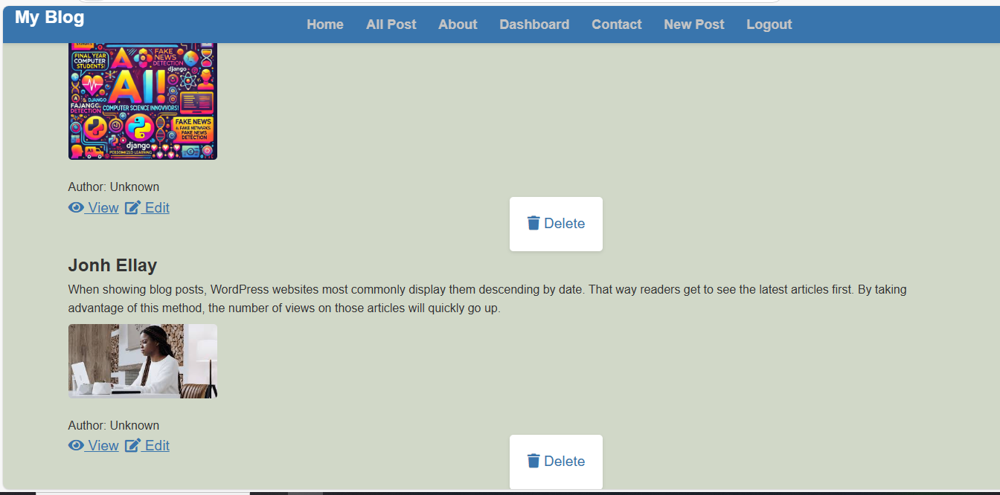

<sub>React, Node.js, MongoDB</sub>

</td>
<td width="33%" align="center">

**🛒 E-Commerce Platform**


<sub>React, Django, PostgreSQL</sub>

</td>
<td width="33%" align="center">

**📚 Study Hub**

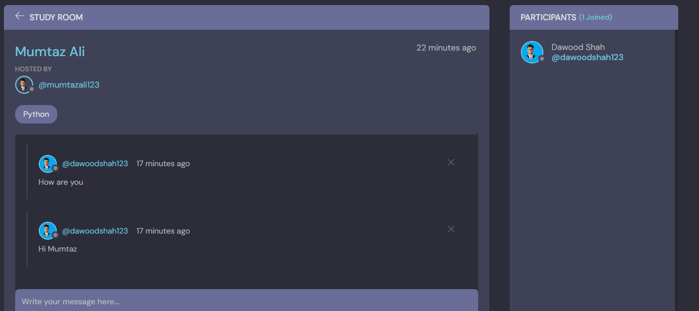

<sub>React, Firebase, Material-UI</sub>

</td>
</tr>
<tr>
<td width="33%" align="center">

**👋 Hand Gesture Recognition**

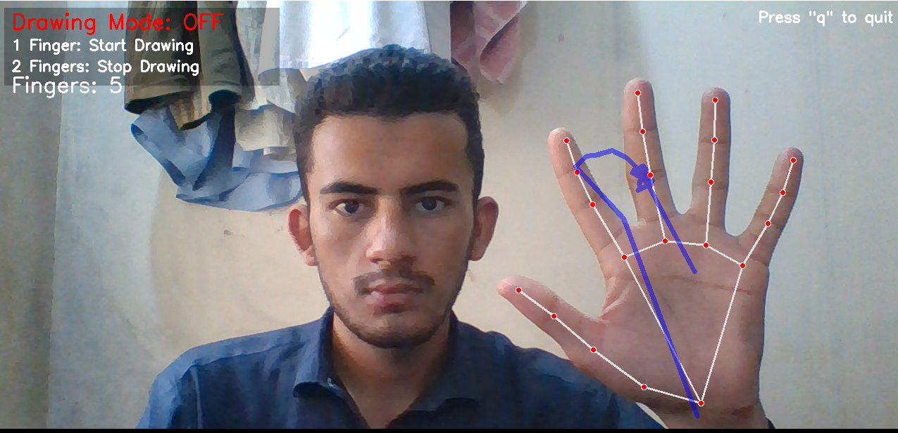

<sub>Python, OpenCV, TensorFlow</sub>

</td>
<td width="33%" align="center">

**🎯 Object Detection System**

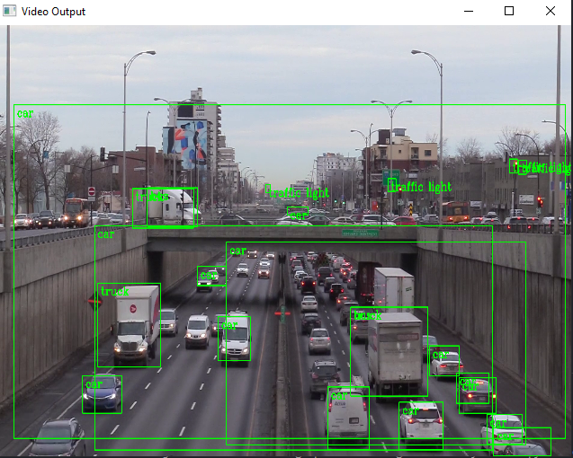

<sub>Python, YOLO, OpenCV</sub>

</td>
<td width="33%" align="center">

**🧠 Personality Prediction**

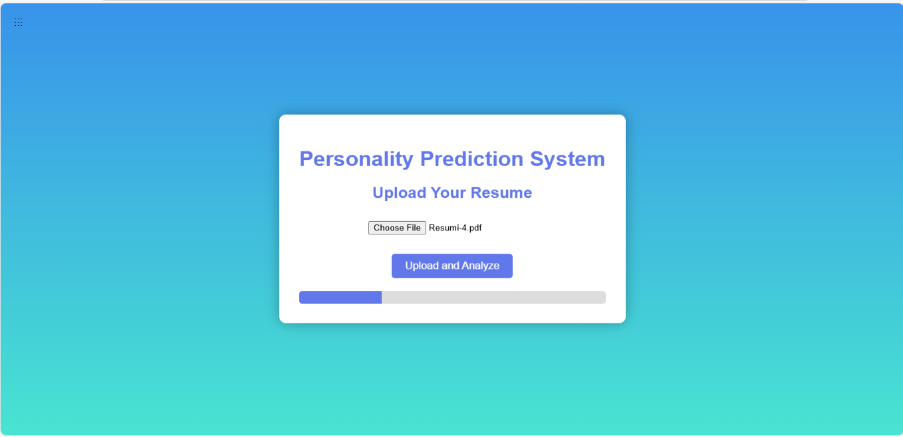

<sub>Python, Scikit-learn, Flask</sub>

</td>
</tr>
<tr>
<td width="33%" align="center">

**🎮 Quiz Game**

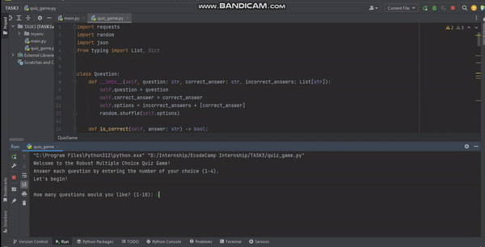

<sub>JavaScript, HTML5, CSS3</sub>

</td>
<td width="33%" align="center">

**🎲 Hangman Adventure**

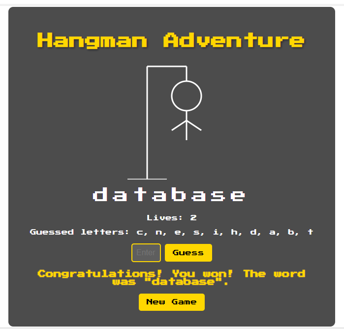

<sub>Django, Python, Bootstrap</sub>

</td>
<td width="33%" align="center">

**📊 World Bank Data Analysis**

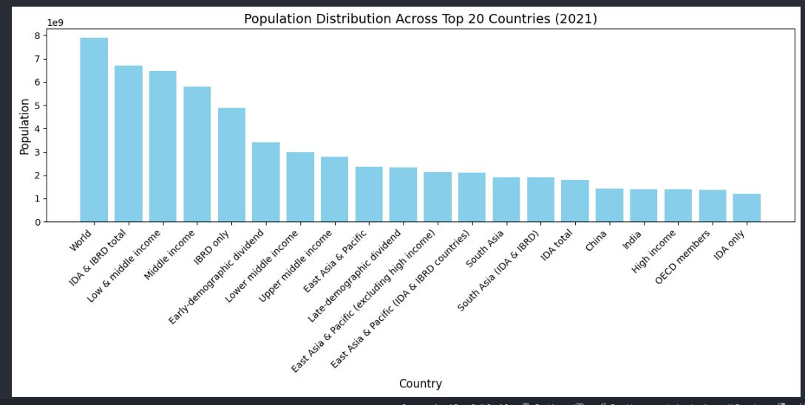

<sub>Python, Pandas, Matplotlib</sub>

</td>
</tr>
<tr>
<td width="33%" align="center">

**🚢 Titanic Dataset Analysis**

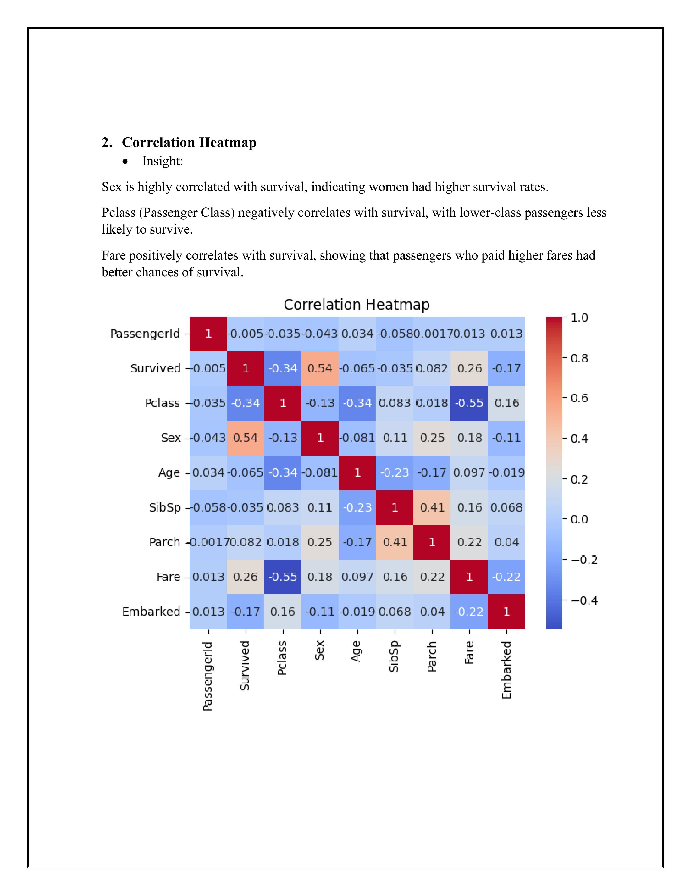

<sub>Python, Pandas, Seaborn</sub>

</td>
<td width="33%" align="center">

**🎵 Modern Music Player**

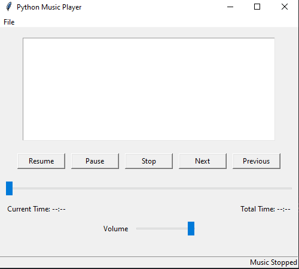

<sub>React, Web Audio API, CSS3</sub>

</td>
<td width="33%" align="center">

**📄 Plagiarism Detector**

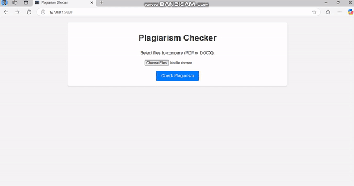

<sub>Python, NLP, Flask</sub>

</td>
</tr>
<tr>
<td width="33%" align="center">

**🎤 Voice Assistant**

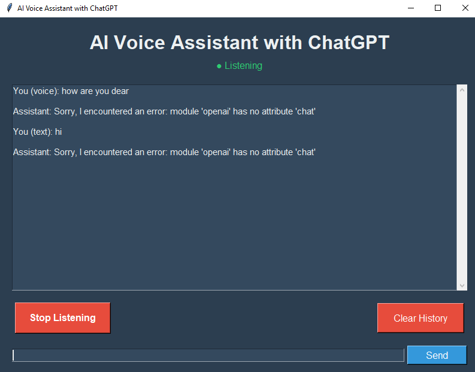

<sub>Python, Speech Recognition</sub>

</td>
<td width="33%" align="center">

**💎 Jewelry Shop Store**

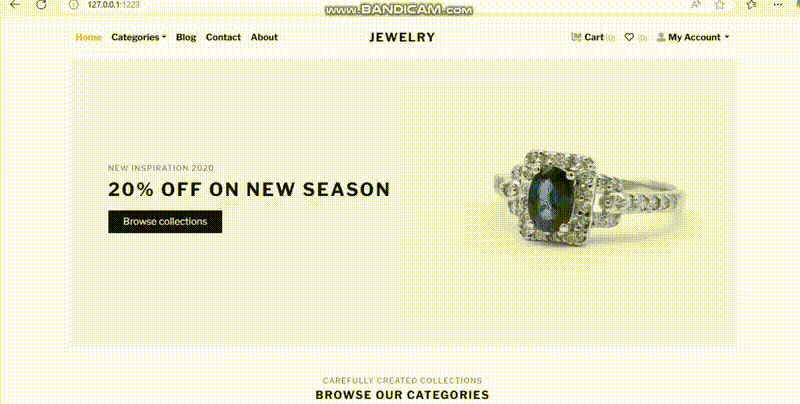

<sub>React, Node.js, MongoDB</sub>

</td>
<td width="33%" align="center">

**🔍 Amazon Scraping Tool**

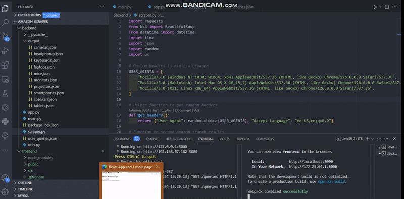

<sub>Python, BeautifulSoup, Selenium</sub>

</td>
</tr>
<tr>
<td width="33%" align="center">

**🔄 Flask CI/CD Demo**

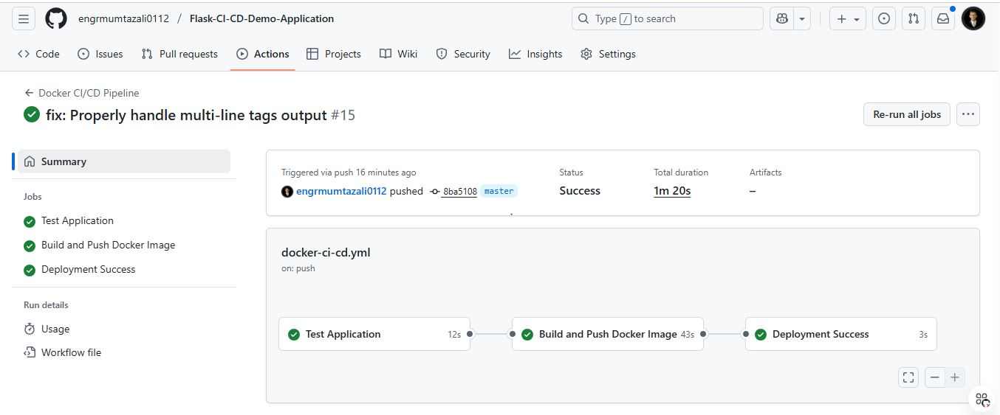

<sub>Flask, Docker, GitHub Actions</sub>

</td>
<td width="33%" align="center">

**🏨 Hostel Management**

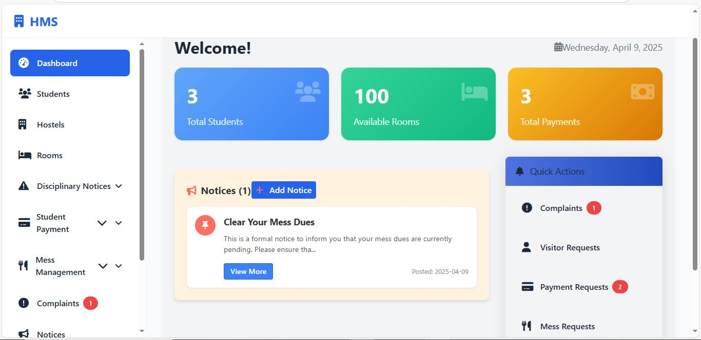

<sub>PHP, MySQL, Bootstrap</sub>

</td>
<td width="33%" align="center">

**👆 Fingerprint Attendance**

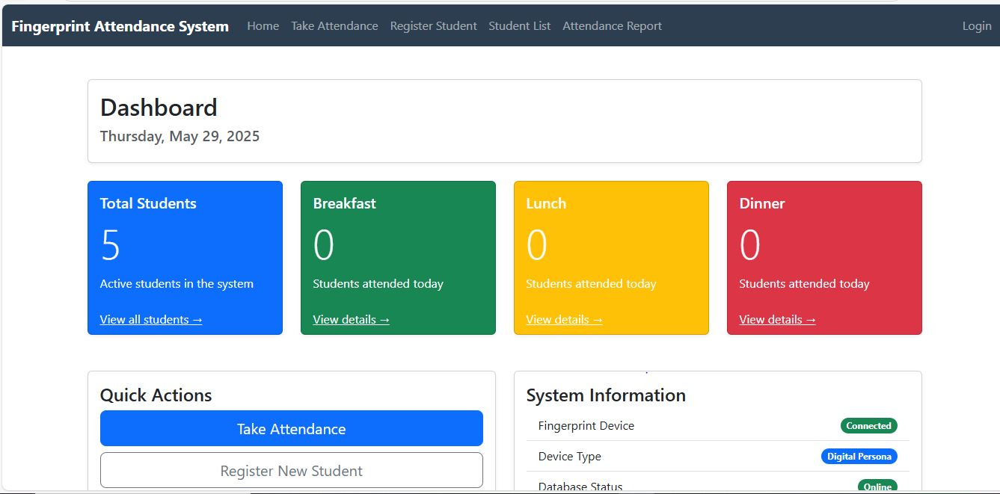

<sub>Arduino, Python, MySQL</sub>

</td>
</tr>
<tr>
<td width="33%" align="center">

**📖 Cloud Book Store**

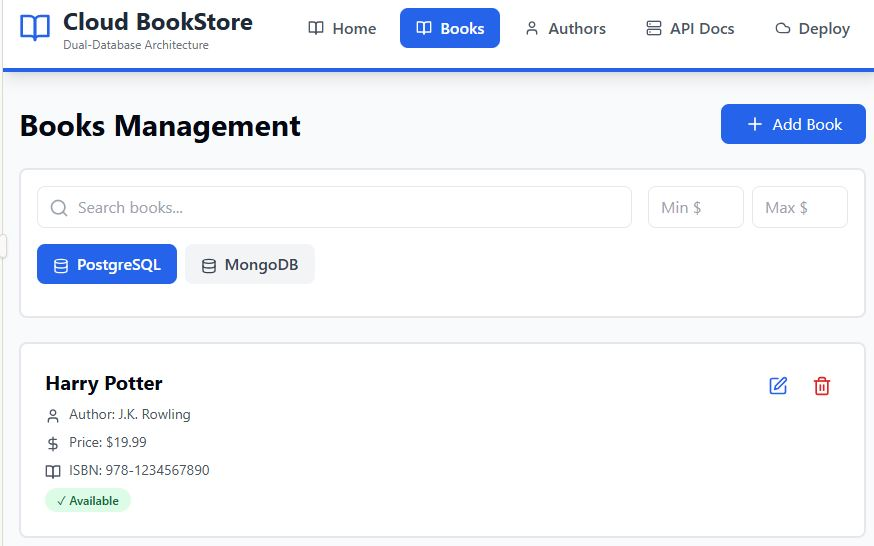

<sub>React, Firebase, Stripe</sub>

</td>
<td width="33%"></td>
<td width="33%"></td>
</tr>
</table>

</div>

> Each live card on the site also links to its Live Demo and GitHub source. The gallery shows 19 of the 22 cards.

**Project catalog (representative)**

| # | Project | Category | Core technologies |
| --- | --- | --- | --- |
| 1 | Blog Website | Full Stack | React, Node.js, MongoDB |
| 2 | E-Commerce Platform | Full Stack | React, Django, PostgreSQL |
| 3 | Study Hub | Education | React, Firebase, Material-UI |
| 4 | Hand Gesture Recognition | AI/ML | Python, OpenCV, TensorFlow |
| 5 | Object Detection System | Computer Vision | Python, YOLO, OpenCV |
| 6 | Personality Prediction | Machine Learning | Python, Scikit-learn, Flask |
| 7 | Multiple Choice Quiz | Game | JavaScript, HTML5, CSS3 |
| 8 | Hangman Adventure | Game | Django, Python, Bootstrap |
| 9 | World Bank Population Data | Data Science | Python, Pandas, Matplotlib |
| 10 | Titanic Dataset Analysis | Data Science | Python, Pandas, Seaborn |
| 11 | Modern Music Player | Entertainment | React, Web Audio API, CSS3 |
| 12 | Document Plagiarism Detector | NLP / Utility | Python, NLP, Flask |
| 13 | Voice Assistant | AI | Python, Speech Recognition, pyttsx3 |
| 14 | Jewelry Shop Store | E-Commerce | React, Node.js, MongoDB |
| 15 | Amazon Scraping Tool | Automation | Python, BeautifulSoup, Selenium |
| 16 | Flask CI/CD Demo | DevOps | Flask, Docker, GitHub Actions |
| 17 | Hostel Management System | Management | PHP, MySQL, Bootstrap |
| 18 | Fingerprint Attendance | IoT | Arduino, Python, MySQL |
| 19 | Cloud Book Store | E-Commerce | React, Firebase, Stripe |

> The deployed site shows 22 cards. `WorkCardData.js` is the source of truth for the full and current list.

### 5.6 Pricing Cards

Shows service pricing so clients know what to expect.

| **Used by** | Prospective clients |
| --- | --- |
| **Components** | `PricingCards.js` / `PricingCardsStyles.css` |
| **Routes** | `/` and `/project` |
| **Status** | Live |

### 5.7 Experience and Education

A **Git-style** record of academic history and certifications.

| **Used by** | Recruiters |
| --- | --- |
| **Components** | `Education.js` / `EducationStyles.css` |
| **Route** | `/education` |
| **Status** | Live |

**Visitor experience**

- Each entry looks like a **commit**, with a hash, message and date.
- **Progress bars** show completion or proficiency.
- Certifications are listed alongside the academic record.

<div align="center">

**🏆 Certifications and Achievements**

| Certification | Organization | Year |
| --- | --- | :---: |
| 🎓 Frontend Development | Digital Empowerment Pakistan | 2024 |
| 🎓 Backend Development (Django) | Digital Empowerment Pakistan | 2024 |
| 🎓 Full Stack Development | Udemy | 2024 |
| 🎓 Python Programming | HackerRank | 2023 |
| 🎓 Machine Learning | Coursera | 2023 |
| 🏅 Programming Competition | University Competition | 2023 |

</div>

### 5.8 Client Reviews

A testimonial **carousel**.

| **Used by** | Prospective clients |
| --- | --- |
| **Components** | `ReviewsSection.js` / `ReviewsSectionStyles.css` |
| **Routes** | `/review` (also previewed on `/`) |
| **Status** | Live |

**Rules and behavior:** the card at the center is highlighted automatically as the carousel moves, so the visitor always knows which review is in focus.

### 5.9 Contact Form

Lets visitors send a message that arrives in the owner's Gmail inbox.

| **Used by** | All visitors |
| --- | --- |
| **Components** | `Form.js` / `FormStyles.css` |
| **Route** | `/contact` |
| **External service** | EmailJS |
| **Status** | Live |

**How it works**

1. The visitor fills in the form fields.
2. **Client-side validation** checks the required fields and the email format.
3. On submit, the browser calls **EmailJS** with the service ID, template ID and public key.
4. EmailJS sends the message to the owner's inbox.
5. The visitor sees a **success screen**.

**Rules and behavior**

- Invalid input is blocked before anything is sent, with inline error messages.
- The success screen is shown **even if EmailJS fails**. The inbox only receives the message if delivery succeeds (see Known Issues).

### 5.10 Theme, Animations and Responsiveness

| **Used by** | All visitors |
| --- | --- |
| **Files** | `index.css` (global reset and white body), `LightTheme.css` (white-theme overrides), per-component CSS |
| **Status** | Live |

- **White professional theme:** clean typography, generous whitespace and subtle shadows.
- **Animations:** floating stat cards, hover lifts and fade-ins.
- **Mobile-first:** hamburger drawer, stacked grids and optimized touch targets.

### 5.11 Error Handling (404)

Unknown routes currently render a **blank page**. A friendly 404 page with a link home is on the roadmap.

| **Status** | Planned |
| --- | --- |

### 5.12 SEO and Social Previews

| **Files** | `public/index.html`, `public/manifest.json` |
| --- | --- |
| **Status** | Live (partial) |

- Basic meta tags, favicon and web manifest are in place.
- **Open Graph and Twitter Card tags are not added yet**, so social previews use the defaults.

---

## 📂 6. Data Model Reference

There is no database. Content is stored in JavaScript modules.

| File | Purpose | Used by |
| --- | --- | --- |
| `src/data/profileData.js` | Single source of profile facts: name, role, location, contact links, social handles. | Hero, Bio, About, Footer, Contact |
| `src/Components/WorkCardData.js` | Array of project entries: title, description, image, tech stack, demo URL, source URL. | Work, WorkCard |

**Typical project entry**

```js
{
  title: "Project Name",
  text: "One or two lines describing the project.",
  img: projectImage,          // imported from src/assets
  tech: "React, Node.js",
  view: "https://live-demo-url",
  source: "https://github.com/engrmumtazali0112/repo-name",
}
```

> Field names may differ slightly in `WorkCardData.js`. Match the existing entries when adding a new one.

---

## 🎨 7. Design System

| Token | Value |
| --- | --- |
| Background | `#ffffff` |
| Surface | `#f8fafc` |
| Border | `#e5e7eb` |
| Text primary | `#0f172a` |
| Text muted | `#64748b` |
| Accent | `#4f46e5` |
| Accent soft | `#eef2ff` |
| Success | `#22c55e` |
| Danger | `#ef4444` |

**Typography:** Outfit for headings and body, JetBrains Mono for code-style labels (both from Google Fonts).

**Icons:** React Icons (Font Awesome pack).

---

## 🔌 8. Integrations

### 8.1 EmailJS (Contact Form)

| Item | Detail |
| --- | --- |
| Purpose | Send contact-form messages to Gmail without a backend |
| Used in | `src/Components/Form.js` |
| Initialization | `public/index.html` |
| Needs | Service ID, Template ID, Public Key |

**Use your own account**

1. Sign up at [emailjs.com](https://www.emailjs.com).
2. Create an email service and a template.
3. Put the three values in environment variables (recommended) or in the constants at the top of `Form.js`.

```env
REACT_APP_EMAILJS_SERVICE_ID=your_service_id
REACT_APP_EMAILJS_TEMPLATE_ID=your_template_id
REACT_APP_EMAILJS_PUBLIC_KEY=your_public_key
```

```js
const EMAILJS_SERVICE_ID  = process.env.REACT_APP_EMAILJS_SERVICE_ID;
const EMAILJS_TEMPLATE_ID = process.env.REACT_APP_EMAILJS_TEMPLATE_ID;
const EMAILJS_PUBLIC_KEY  = process.env.REACT_APP_EMAILJS_PUBLIC_KEY;
```

> Add the same variables in the Vercel project settings before deploying.

### 8.2 Google Fonts

Outfit and JetBrains Mono are loaded from Google Fonts.

### 8.3 Vercel

Builds and hosts the site. Auto-deploys on every push to `main`.

---

## 🔒 9. Security and Privacy

| Topic | Detail |
| --- | --- |
| Attack surface | Minimal: static files only, no server, no database, no user accounts. |
| EmailJS public key | Designed to be public, but it is visible in the browser bundle. Restrict allowed domains and set rate limits in the EmailJS dashboard. |
| Spam protection | Client-side validation only. Consider adding a CAPTCHA or a honeypot field if spam appears. |
| Personal data | Messages go to the owner's inbox through EmailJS. The site stores nothing. |
| Secrets | Keep private values out of the repository. Use environment variables for configuration. |
| Dependencies | Run `npm audit` periodically and update packages. |

---

## 🚀 10. Configuration, Build and Deployment

### 10.1 Quick Start

```bash
# Clone
git clone https://github.com/engrmumtazali0112/my_portfolio.git
cd my_portfolio

# Install
npm install

# Dev server (port 3000)
npm start

# Production build
npm run build

# Preview production build
npx serve -s build
```

**Requirements:** Node.js 14 or higher (18 recommended), npm 6 or higher.

### 10.2 Available Scripts

| Command | Description |
| --- | --- |
| `npm start` | Runs the app in development mode on port 3000 |
| `npm test` | Launches the test runner |
| `npm run build` | Builds the app for production into `build/` |
| `npm run eject` | Ejects from Create React App (one-way, avoid) |

### 10.3 Routes

| Path | Page | Purpose |
| --- | --- | --- |
| `/` | Home | Hero, Bio, Work, Services, Pricing and Reviews |
| `/about` | About | Profile card and long-form bio |
| `/services` | Services | 9 service offerings |
| `/project` | Projects | 22 project cards and pricing |
| `/education` | Experience | Academic record and certifications |
| `/review` | Reviews | Client testimonial carousel |
| `/contact` | Contact | Contact form (EmailJS) |

### 10.4 Project Structure

```text
my_portfolio/
├── public/
│   ├── index.html              EmailJS init + meta tags
│   ├── favicon.ico
│   └── manifest.json
├── src/
│   ├── Components/
│   │   ├── Hero.js / HeroStyle.css
│   │   ├── Bio.js / BioStyle.css
│   │   ├── Navbar.js / NavbarStyle.css
│   │   ├── Footer.js / FooterStyles.css
│   │   ├── Work.js / WorkCard.js / WorkCardData.js / WorkCardStyles.css
│   │   ├── ServicesSection.js / ServicesSectionStyles.css
│   │   ├── PricingCards.js / PricingCardsStyles.css
│   │   ├── ReviewsSection.js / ReviewsSectionStyles.css
│   │   ├── AboutContent.js / AboutContentStyles.css
│   │   ├── Education.js / EducationStyles.css
│   │   └── Form.js / FormStyles.css
│   ├── Routes/
│   │   ├── Home.js
│   │   ├── About.js
│   │   ├── Service.js
│   │   ├── Project.js
│   │   ├── Education.js
│   │   ├── Review.js
│   │   └── Contact.js
│   ├── data/
│   │   └── profileData.js      Single source of profile facts
│   ├── assets/                 Images and GIFs used across pages
│   ├── App.js                  Route definitions
│   ├── index.js                React entry point
│   ├── index.css               Global reset + white body
│   └── LightTheme.css          White-theme overrides
└── README.md                   This file
```

### 10.5 Deploy to Vercel

**Option A: Dashboard (recommended)**

1. Push the code to GitHub.
2. Go to [vercel.com/new](https://vercel.com/new) and import `my_portfolio`.
3. Framework preset: **Create React App** (auto-detected).
4. Add the EmailJS environment variables.
5. Click **Deploy**.

**Option B: CLI**

```bash
npm install -g vercel
vercel login
vercel --prod
```

Vercel redeploys automatically on every push to `main`. A full deploy takes under two minutes.

---

## 🧪 11. Testing and Quality Targets

Testing is **manual plus Lighthouse**. No automated tests are configured yet.

| Lighthouse category | Target |
| --- | --- |
| Performance | 90 or higher |
| Accessibility | 95 or higher |
| Best Practices | 95 or higher |
| SEO | 90 or higher |

**Manual checklist**

- [ ] All seven routes load and the navigation highlights the current page.
- [ ] Hamburger drawer opens and closes on a phone-sized screen.
- [ ] Every project card has a working Live Demo and GitHub link.
- [ ] Contact form blocks empty and invalid input.
- [ ] A valid contact submission arrives in the inbox.
- [ ] Reviews carousel highlights the center card.
- [ ] No horizontal scrolling at 375 px width.

Test locally with `npx serve -s build` and run Lighthouse in Chrome DevTools.

---

## 📋 12. Implementation Status, Known Issues and Roadmap

### 12.1 Module Status

| Module | Status |
| --- | --- |
| Navigation and Layout | Live |
| Home, About, Services, Projects, Education, Reviews | Live |
| Contact Form (EmailJS) | Live |
| Theme and Responsiveness | Live |
| SEO and Social Previews | Live (partial) |
| 404 Page | Planned |

### 12.2 Known Issues

| Issue | Impact | Suggested fix |
| --- | --- | --- |
| Unknown routes render a blank page | Visitors who mistype a URL see nothing | Add a catch-all `*` route with a 404 page |
| `.HEIC` images in `src/assets/` do not render in browsers | Broken images | Convert to `.jpg` or `.png` |
| No Open Graph or Twitter Card tags | Plain link previews when shared | Add meta tags to `public/index.html` |
| Success screen shows even if EmailJS fails | Visitor may think a failed message was sent | Show an error state and a fallback email address |

### 12.3 Roadmap

- [ ] Custom domain (for example `mumtazali.dev`)
- [ ] Open Graph and Twitter Card meta tags
- [ ] Vercel Analytics
- [ ] 404 page
- [ ] Blog / Insights section
- [ ] Dark mode toggle
- [ ] Multi-language support (English / Urdu)
- [ ] EmailJS error handling and spam protection

### 12.4 Contributing

This is a personal portfolio, but pull requests for typo fixes and accessibility improvements are welcome.

```bash
# Fork, clone, branch, commit, push, open a PR
git checkout -b fix/typo-in-about
git commit -m "fix: typo in About section"
git push origin fix/typo-in-about
```

---

## 📄 13. License

MIT. Free to learn from, fork and adapt. Attribution is appreciated but not required.

---

## 📞 14. Contact

<div align="center">

### Let's Connect! 🤝

<a href="mailto:engrmumtazali01@gmail.com"></a>
<a href="https://www.linkedin.com/in/mumtazali12/"></a>
<a href="https://github.com/engrmumtazali0112"></a>
<a href="https://www.hackerrank.com/profile/engrmumtazali01"></a>
<a href="https://x.com/mumtazali1223"></a>
<a href="https://www.instagram.com/its_maliyzi"></a>

</div>

| Channel | Handle |
| --- | --- |
| Email | [engrmumtazali01@gmail.com](mailto:engrmumtazali01@gmail.com) |
| GitHub | [@engrmumtazali0112](https://github.com/engrmumtazali0112) |
| LinkedIn | [mumtazali12](https://www.linkedin.com/in/mumtazali12/) |
| Twitter / X | @mumtazali1223 |
| Instagram | @its_maliyzi |
| HackerRank | [engrmumtazali01](https://www.hackerrank.com/profile/engrmumtazali01) |

<div align="center">

Built with ❤️ by **Mumtaz Ali**

⭐ Star this repo if it helped you


</div>